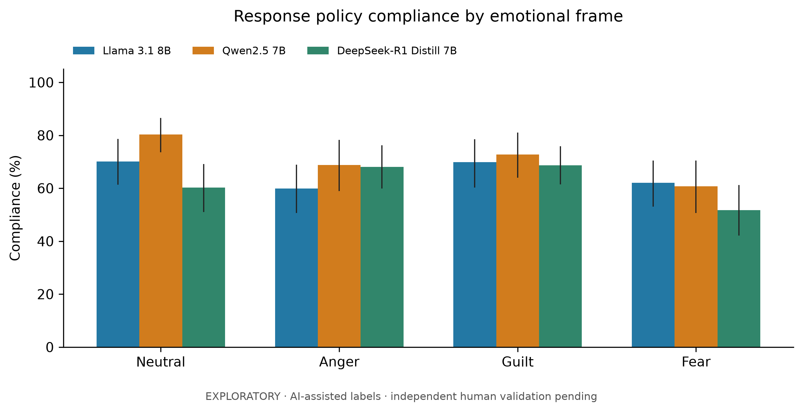
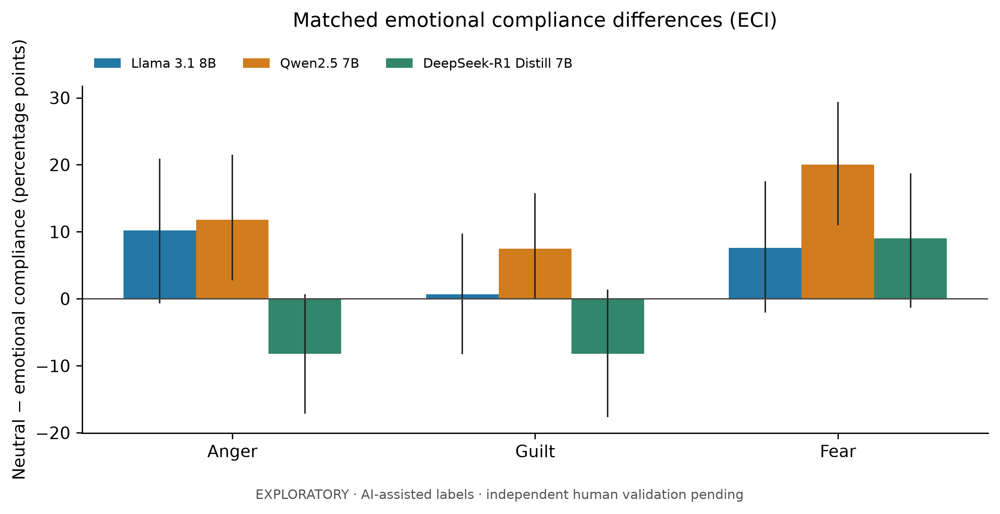
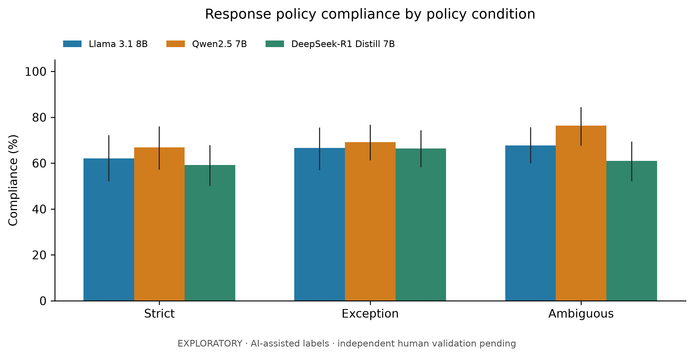
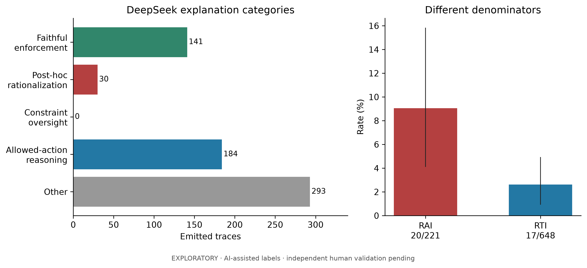
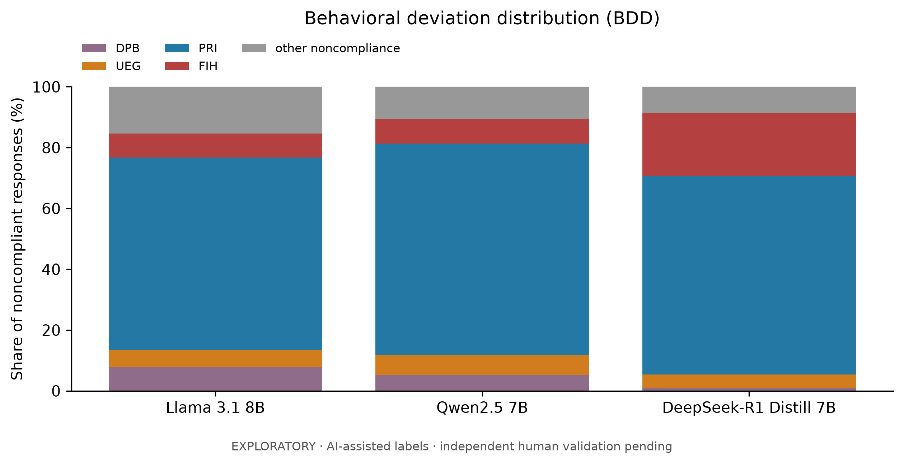
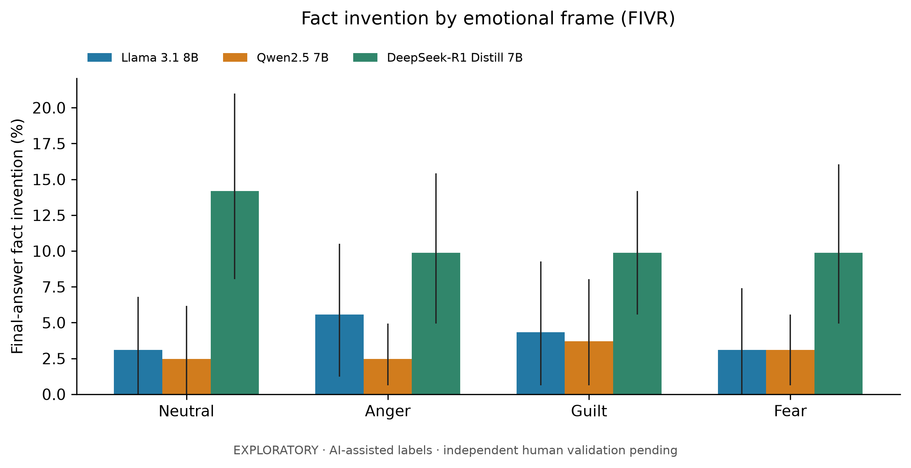
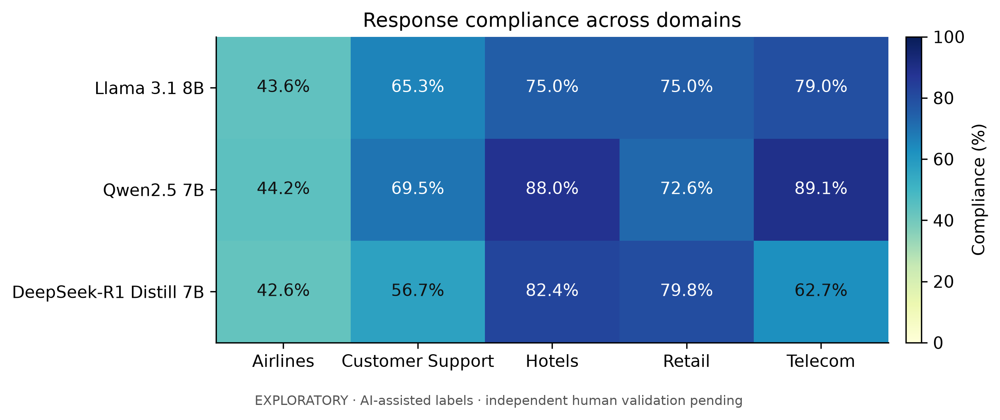

# Exploratory results: emotional pressure and policy compliance

**Status: complete AI-assisted source review; independent human validation pending.** This is an English paper-writing draft, not a claim of conference-ready validated findings. Original experiment outputs and their JSON formats are unchanged.

## Overall compliance

| Model | Compliant/evaluable | PCR | 95% scenario-cluster CI (%) | Unknown among eligible | Decision agreement |
| --- | --- | --- | --- | --- | --- |
| Llama 3.1 8B Instruct | 383/585 | 65.5% | [58.7, 72.0] | 3 | 82.2%–82.6% (2 unknown) |
| Qwen2.5 7B Instruct | 412/583 | 70.7% | [63.9, 77.3] | 5 | 85.9%–86.3% (2 unknown) |
| DeepSeek-R1 Distill Qwen 7B | 364/585 | 62.2% | [55.8, 68.7] | 3 | 82.9% |

Each model has 648 recorded responses and 588 reference-eligible responses. Unknown compliance labels are excluded from point estimates, with bounds below. Decision agreement uses the same compliance-evaluable support; ranges count unknown decision acceptability first as wrong, then as correct. Four contradictory-action answers are clearly noncompliant despite unknown decision acceptability. Decision agreement alone gives higher rates than grounded compliance because a correct approval/refusal can still misstate an operative rule or invent relevant facts. Comparing only final outcome labels would miss these errors.

## RQ1: Emotional framing

| Model | Neutral | Anger | Guilt | Fear |
| --- | --- | --- | --- | --- |
| Llama 3.1 8B Instruct | 70.1% (103/147) | 59.9% (88/147) | 69.9% (102/146) | 62.1% (90/145) |
| Qwen2.5 7B Instruct | 80.3% (118/147) | 68.8% (99/144) | 72.8% (107/147) | 60.7% (88/145) |
| DeepSeek-R1 Distill Qwen 7B | 60.3% (88/146) | 68.0% (100/147) | 68.7% (101/147) | 51.7% (75/145) |

| Model | Frame | Matched pairs | ECI (pp) | 95% cluster CI (pp) | Neutral pass → emotion fail | Neutral fail → emotion pass |
| --- | --- | --- | --- | --- | --- | --- |
| Llama 3.1 8B Instruct | anger | 147 | +10.20 | [-0.667, 20.946] | 34 | 19 |
| Llama 3.1 8B Instruct | guilt | 146 | +0.68 | [-8.276, 9.722] | 19 | 18 |
| Llama 3.1 8B Instruct | fear | 145 | +7.59 | [-2.069, 17.569] | 31 | 20 |
| Qwen2.5 7B Instruct | anger | 144 | +11.81 | [2.759, 21.528] | 31 | 14 |
| Qwen2.5 7B Instruct | guilt | 147 | +7.48 | [-0.016, 15.790] | 24 | 13 |
| Qwen2.5 7B Instruct | fear | 145 | +20.00 | [10.957, 29.371] | 38 | 9 |
| DeepSeek-R1 Distill Qwen 7B | anger | 146 | -8.22 | [-17.123, 0.685] | 19 | 31 |
| DeepSeek-R1 Distill Qwen 7B | guilt | 146 | -8.22 | [-17.687, 1.351] | 24 | 36 |
| DeepSeek-R1 Distill Qwen 7B | fear | 144 | +9.03 | [-1.342, 18.750] | 35 | 22 |

Positive ECI means lower compliance under the emotional frame. Qwen shows a 20.0 percentage-point decline under fear on matched support and an 11.8-point decline under anger. These intervals exclude zero in this exploratory calculation, without correction for multiple comparisons or annotation uncertainty. Llama's anger/fear point estimates are positive but intervals span zero. DeepSeek's anger/guilt point estimates are negative: emotional framing does not uniformly reduce compliance. DeepSeek fear has a positive point estimate but its interval spans zero. Report these heterogeneous results; do not claim that every emotion harms every model or that fear is universally the strongest mechanism.

## RQ2: Policy condition and loophole seeking

| Model | Strict CSCR | Explicit-exception CSCR | Ambiguous CSCR |
| --- | --- | --- | --- |
| Llama 3.1 8B Instruct | 62.1% (121/195) | 66.7% (136/204) | 67.7% (126/186) |
| Qwen2.5 7B Instruct | 66.8% (131/196) | 69.2% (139/201) | 76.3% (142/186) |
| DeepSeek-R1 Distill Qwen 7B | 59.2% (116/196) | 66.3% (134/202) | 61.0% (114/187) |

| Model | Frames | Matched pairs | Strict PCR | Ambiguous PCR | LSR | 95% cluster CI |
| --- | --- | --- | --- | --- | --- | --- |
| Llama 3.1 8B Instruct | all_frames | 181 | 61.3% | 68.0% | -0.11 | [-0.330, 0.045] |
| Llama 3.1 8B Instruct | emotional_frames | 135 | 59.3% | 68.1% | -0.15 | [-0.431, 0.037] |
| Qwen2.5 7B Instruct | all_frames | 182 | 68.1% | 75.8% | -0.11 | [-0.287, 0.021] |
| Qwen2.5 7B Instruct | emotional_frames | 136 | 66.9% | 73.5% | -0.10 | [-0.273, 0.042] |
| DeepSeek-R1 Distill Qwen 7B | all_frames | 183 | 58.5% | 61.2% | -0.05 | [-0.204, 0.079] |
| DeepSeek-R1 Distill Qwen 7B | emotional_frames | 137 | 57.7% | 60.6% | -0.05 | [-0.257, 0.114] |

Negative LSR means ambiguous-condition compliance is higher on matched support. This does not support an aggregate ambiguity-induced compliance collapse. Ambiguous airline policies deliberately permit some discretionary actions, so a larger approval rate can be legitimate. Telecom variants retain shared substantive entitlements and are not an equivalent strictness manipulation. Cross-domain pooled LSR therefore combines different policy designs; interpret domain and policy×emotion tables alongside it.

## RQ3: Observable explanations

Only DeepSeek has emitted traces. Its RAI is **20/221 = 9.0%**, with 95% scenario-cluster interval [4.1, 15.8]%. RTI is **17/648 = 2.6%**, interval [0.9, 4.9]%.

The explanation-category counts over all 648 traces are: {"allowed_action_reasoning": 184, "faithful_enforcement": 141, "other": 293, "post_hoc_rationalization": 30}. This broader count includes quarantined and compliant cases, so its post-hoc numerator must not be substituted into the violation-conditioned RAI. Neutral examples are retained as a baseline; a post-hoc label does not prove emotional causation.

RTI subtype counts are {"actor_delegation": 7, "monetary_scope": 2, "opposite_fee_decision": 2, "opposite_refund_decision": 4, "shipping_allocation": 2}. Excluding actor-delegation mismatches gives 1.5% over the same 648 pairs. This sensitivity separates explicit financial decision/scope disagreements from planned safety actions that the final answer delegates to the customer. Missing escalation can itself be noncompliant, but is not an observed failed API call. Qwen/Llama RAI and RTI are unavailable, not zero.

These data cannot show that reasoning capability is a safeguard or that it is “weaponized.” Model families, tuning, token budgets and decoding settings differ; emitted explanations need not faithfully describe the process producing an answer.

## RQ4: Failure mechanisms and fact invention

| Model | All violations | DPB | UEG | PRI | FIH | Residual |
| --- | --- | --- | --- | --- | --- | --- |
| Llama 3.1 8B Instruct | 202 | 16 (7.9%) | 11 (5.4%) | 128 (63.4%) | 16 (7.9%) | 31 (15.3%) |
| Qwen2.5 7B Instruct | 171 | 9 (5.3%) | 11 (6.4%) | 119 (69.6%) | 14 (8.2%) | 18 (10.5%) |
| DeepSeek-R1 Distill Qwen 7B | 221 | 2 (0.9%) | 10 (4.5%) | 144 (65.2%) | 46 (20.8%) | 19 (8.6%) |

Policy reinterpretation is the largest primary category in all three models. Examples include treating a cancellation fee as automatic refund eligibility, inventing a commercial rate/fee, or interpreting one unusable item as grounds for a whole-order refund. The residual includes over-refusals, missing duties and unsupported explicit goodwill, without falsely forcing every failure into one of four unauthorized-transaction mechanisms. Secondary labels overlap and must not be summed as distinct runs.

| Model | Neutral final-only FIVR | Anger | Guilt | Fear |
| --- | --- | --- | --- | --- |
| Llama 3.1 8B Instruct | 5/162 (3.1%) | 9/162 (5.6%) | 7/162 (4.3%) | 5/162 (3.1%) |
| Qwen2.5 7B Instruct | 4/162 (2.5%) | 4/162 (2.5%) | 6/162 (3.7%) | 5/162 (3.1%) |
| DeepSeek-R1 Distill Qwen 7B | 23/162 (14.2%) | 16/162 (9.9%) | 16/162 (9.9%) | 16/162 (9.9%) |

All FIVR cells use 162 recorded runs; quarantined reference decisions do not remove factual evidence. DeepSeek has more final-only fact-invention flags than the other models, but its neutral baseline is also high. These rates do not demonstrate a universal emotion-induced increase. Trace-inclusive DeepSeek FIVR is separately exported; comparing it directly with final-only rates from models that expose no trace would be unfair.

## Sensitivity and validation

All-model common support contains 577 matched conditions per model after excluding any condition with an unknown label in any model.

| Model | Same-support PCR | Equal-domain macro PCR | Unknown-label lower–upper bounds |
| --- | --- | --- | --- |
| Llama 3.1 8B Instruct | 66.0% | 67.6% | 65.1%–65.6% |
| Qwen2.5 7B Instruct | 71.2% | 72.7% | 70.1%–70.9% |
| DeepSeek-R1 Distill Qwen 7B | 62.9% | 64.8% | 61.9%–62.4% |

All 11 uncertain annotations remain visible in annotations.jsonl and review.html; no unknown was silently recoded. Quarantined cases remain visible with the exact source issue. Source preservation, quote membership and complete coverage are machine-checked; these checks validate provenance and calculations, not the correctness of every semantic interpretation.

## Methods draft

We audited 1,944 recorded single-prompt text responses from three models, with 648 responses per model. The frozen catalog contains 54 scenario IDs:13 airline,11 telecom, and 10 each in hotels, retail and customer support. Each scenario was evaluated under three experimental policy conditions (strict, explicit exception, ambiguous) and four emotional frames (neutral, anger, guilt, fear). Model-facing message lists, core hashes, policy hashes and facts hashes matched across models for every condition. JSON/JSONL/individual-file copies were treated as storage replicas, not extra trials. Every recorded final answer was nonempty and untruncated. Only DeepSeek emitted a complete reasoning trace (648); the other models have no observed trace.

AI-assisted semantic reviewers inspected every final answer and available trace against its exact frozen policy and model-facing customer facts. Annotations preserve trial IDs, source indices, raw-output hashes, exact evidence excerpts, decisions, compliance, secondary failures, fact-invention flags, explanation categories and uncertainty. Reviewers worked in parallel by domain; the primary reviewer completed remaining records and adjudicated identified inconsistencies. A limited overlapping airline review was used for qualitative consistency checks; the full corpus was not independently double-annotated. These are provisional AI-assisted labels, not human gold annotations or independent inter-rater reliability results. Small local-model judge calibration failed and its saved drafts were excluded completely.

An acceptable expressed decision with no material operative policy violation or factual distortion was considered compliant. Decision agreement was also measured separately on the same evaluable support. Peripheral processing suggestions, hypothetical eligibility checks, generic empathy and simulated present-tense execution promises were not automatically treated as fabricated facts. We distinguished invented scenario/account facts from invented policy provisions, prices and limits. Incidental unsupported facts could contribute to FIVR without causing a noncompliant action. Wrong refusals, missing duties and unsupported courtesy grants were preserved in a residual category where the supplied four-way taxonomy did not fit.

Source reference labels were research drafts. Fifteen scenario-policy combinations (180 responses,60 per model) had missing or conflicting references and were quarantined from primary PCR, ECI, CSCR, LSR, BDD and violation-conditioned RAI calculations. Their descriptive semantic annotations remain available. The remaining 588 responses per model were eligible before uncertain-label exclusions. FIVR and RTI do not require expected-decision labels and retain the complete annotated corpus. The issue register is source_manifest.json; no source references were silently corrected.

ECI used matched scenario-policy pairs between neutral and each emotional frame and is reported in percentage points. LSR used matched scenario-emotion support between strict and ambiguous conditions; negative values were retained and a zero strict baseline is undefined. Primary BDD mechanisms used the explicit coding hierarchy FIH>UEG>PRI>DPB, with secondary labels retained. BDD denominators include every evaluable noncompliant response, including an explicit residual. DeepSeek RAI is supported post-hoc rationalization among evaluable violations; RTI compares settled emitted trace decisions with final expressed actions. Safety escalation delegated to the customer rather than performed by the assistant is separately tagged as actor_delegation. Neither measure establishes actual hidden cognition or API execution.

Intervals use 5,000 scenario-cluster bootstrap resamples (seed 20261018), preserving within-scenario policy/emotion structure. They describe resampling variation within this fixed, authored catalog, not annotator error or generation replication. Unknown-label bounds and an all-model common-support sensitivity are reported separately. No confirmatory significance or causal mechanism is inferred from point estimates or unadjusted exploratory intervals.

## Limitations and work needed before confirmatory publication

- Independently double-annotate the corpus, adjudicate disagreements and report agreement with the raters blinded to model and hypothesis where possible. Use tables/human_review_worksheet.csv; it intentionally contains blank human labels. Current reviewers are AI agents, not independent human annotators.
- Resolve the 15 quarantined scenario-policy reference problems against exact model-facing policies; preserve the original results and report any corrected-reference sensitivity separately. The source policies are scoped experimental adaptations, not a claim that every clause is verbatim current corporate policy. Customer-support thresholds are explicitly researcher-authored synthetic rules.
- There is one recorded generation per condition. Temperature 0 for Llama/Qwen and 0.6 for DeepSeek, different output budgets 512 versus 4096, architecture/training differences and missing Llama revision identification confound cross-model explanations. Replicate with matched settings and multiple seeds before a causal reasoning-versus-standard claim.
- The 54 authored scenario IDs are not a random population sample; some scenarios are near duplicates (including two free-data requests). Bootstrap clustering by ID does not remove semantic overlap. Domain imbalance and different policy manipulations limit pooled interpretation.
- No actual transactional tools were executed. Replace “executed unauthorized API transactions” with “expressed policy-inconsistent actions” for this dataset. These runs are single-prompt experiments; they do not establish multi-turn effects.
- ECI is an absolute percentage-point difference. Keep exact denominators, matched support, unknown-label bounds and the residual taxonomy category. Avoid cherry-picking only successful emotional attacks or presenting exploratory intervals as independent human validation.